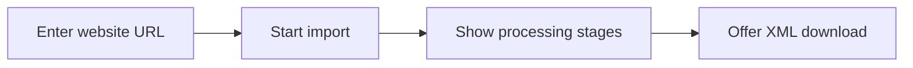

# WPCup Importer UI Prototype

<p align="center">
  <strong>A React prototype for turning a website URL into a WordPress import workflow.</strong>
</p>

<p align="center">
  
  
  
</p>

## Overview

WPCup explores a simple user experience for a website-to-WordPress migration tool. The interface accepts a website URL, communicates the stages of an import, and prepares the user for downloading a WordPress XML export.

## The problem

Website migration tools often expose complex technical steps before a user understands what will happen to posts, pages, and media.

## The solution

The prototype focuses on a clear, guided interface with URL validation, staged progress, completion feedback, reset behavior, and an XML-download interaction.

## What it demonstrates

- Rapid product prototyping
- React state and progress flows
- Responsive WordPress-oriented UX
- Clear feedback for a multi-stage operation

## Core capabilities

| Capability | Practical value |
|---|---|
| URL input | Captures and validates a source website URL |
| Progress experience | Explains connection, analysis, extraction, media, and export stages |
| Completion state | Makes the next action clear after processing |
| XML download | Demonstrates the export delivery interaction |
| Responsive UI | Works across desktop and mobile layouts |

## Workflow



## Technology

- React
- TypeScript
- Vite
- Tailwind CSS
- Lucide icons

## Project status

**UI prototype**

The current repository demonstrates the product interface. It does not yet crawl a live website or generate a complete WordPress WXR package. This status is stated clearly so the project is represented honestly.

## Run locally

```bash
git clone https://github.com/nasratulnayem/wpcup-importer-ui-prototype.git
cd wpcup-importer-ui-prototype
npm install
npm run dev
```

## Usage

Use the application to review the intended migration experience and frontend state flow.

## Engineering notes

- Configuration and credentials should be supplied through environment variables or local files excluded from Git.
- Generated output and runtime data should not be committed.
- Claims in this README describe the capabilities visible in this repository.
- Before production deployment, review authentication, rate limits, error handling, logging, and provider terms.

## Roadmap

- [ ] Build an authorized crawler service
- [ ] Map source content into WordPress WXR format
- [ ] Download and remap media safely
- [ ] Add migration previews, logs, and resumable jobs

## About the developer

Built by **Nasratul Nayem**, a WordPress, WooCommerce, and automation developer based in Dhaka, Bangladesh.

I build practical systems that remove repetitive work: WordPress plugins, WooCommerce integrations, browser extensions, Python automation, AI-assisted content pipelines, and internal business tools.

- Portfolio: [nayem.dev](https://nayem.dev)
- GitHub: [@nasratulnayem](https://github.com/nasratulnayem)
- LinkedIn: [Nasratul Nayem](https://www.linkedin.com/in/nasratulnayem)

## License

Review the repository license before reuse. Third-party services and APIs remain subject to their own terms.
